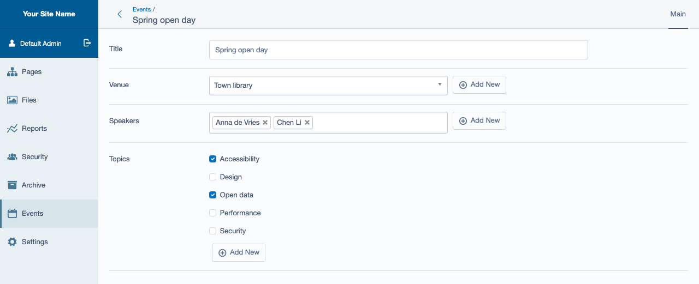
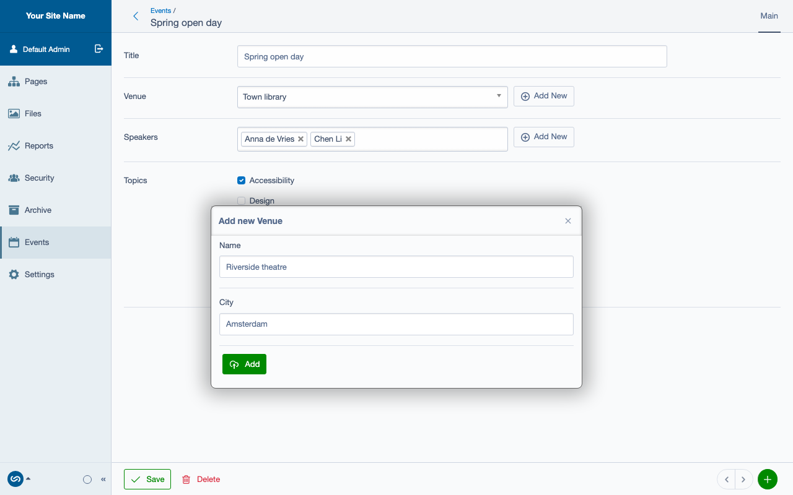
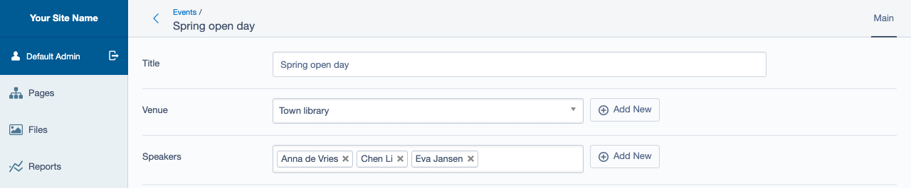

# Quick Add New for Silverstripe

Create a related record without leaving the form you are editing. An **Add New** button next to a
dropdown, listbox or checkbox set opens the related record's form in a dialog; on save the record is
written, the field is refreshed in place and the new record is selected. Works on `has_one`,
`has_many` and `many_many` relations, in the CMS and (with a little setup) on the front end. For
Silverstripe 6; the 2.x line covers Silverstripe 4 and 5.



*Maintained by [Restruct](https://github.com/restruct). If this module saves you time, you can
[support ongoing maintenance](https://github.com/sponsors/restruct).*

## A missing option means leaving the form

A relation field can only offer records that already exist. When the venue, author or category an
editor needs is not in the list yet, they have to save (or abandon) what they are working on, go to
another section, create the record there, come back and pick it. Silverstripe has no built-in way to
create a related record from the field itself.

This module adds one, with a single method call on the field:

- an **Add New button** next to the field, shown only to users who may create that class
  (`canCreate()`);
- a **dialog with the record's form**: its `getAddNewFields()`, or else its `getCMSFields()`, or a
  field list you pass in, with optional required fields;
- the record is **saved over AJAX**, and the field comes back **with the new record selected**.
  Listboxes and checkbox sets keep the selections that were already made;
- **errors stay in the dialog**: required fields are checked before anything is sent, and an
  exception from `write()` (such as a `ValidationException`) is shown as a message in the dialog.

## Add New, step by step

### The dialog

Clicking Add New opens a dialog titled "Add new {singular name}" with the record's form.



### Back in the form, with the new record selected

On Add, the record is written, the dialog closes and the field is refreshed in place with the new
record selected. Here a third speaker was added to a listbox that already had two:



The field still has to be saved with the rest of the form: the dialog writes the new record, the
form's own Save stores the relation.

> Fixed in 3.1.1 (2.2.1 on the `v2` line): before that, a **dropdown** came back with the *last*
> option selected rather than the new record, unless the new record sorted last in the source
> ([#5](https://github.com/restruct/silverstripe-quickaddnew/issues/5)).

### Enabling it on a field

The extension is applied to `DropdownField`, `ListboxField` and `CheckboxSetField` (and their
subclasses), and stays inactive until you call `useAddNew()` on a field.

First write a closure that returns the field's options. It is called once to fill the field, and
again after a record was added, so the refreshed field lists the new one:

```php
$source = function () {
    return Venue::get()->map()->toArray();
};
```

Then create the field with the closure's result as its source, and enable Add New with the class to
create and the same closure:

```php
$field = DropdownField::create('VenueID', 'Venue', $source())
    ->useAddNew(Venue::class, $source);

$fields->addFieldToTab('Root.Main', $field);
```

The closure is passed the newly written record, should you need it.

### What the dialog shows

By default the dialog uses the created class's fields:

1. the `$fields` argument of `useAddNew()`, if you pass one;
2. otherwise the class's `getAddNewFields()` method, if it has one;
3. otherwise its `getCMSFields()`.

Required fields work the same way: the `$required` argument, otherwise the class's
`getAddNewValidator()` method, if it has one. A short form with its own validator is usually what
you want in a dialog:

```php
use SilverStripe\Forms\FieldList;
use SilverStripe\Forms\TextField;
use SilverStripe\Forms\Validation\RequiredFieldsValidator;

class Venue extends DataObject
{
    public function getAddNewFields()
    {
        return FieldList::create(
            TextField::create('Title', 'Name'),
            TextField::create('City')
        );
    }

    public function getAddNewValidator()
    {
        return RequiredFieldsValidator::create(['Title']);
    }
}
```

### The dialog title

The dialog is titled "Add new {singular name}" (i18n key `QUICKADDNEW.AddNewTitle`, using the
class's `i18n_singular_name()`). To override it for one field, for instance when two fields create
the same class under different relations:

```php
$field->useAddNew(Venue::class, $source)->setAddNewDialogTitle('Add an overflow venue');
```

Passing `null` restores the default. `getAddNewDialogTitle()` returns the title the dialog will get.

### On the front end

`useAddNew()` also works on a front-end form. Pass `true` as its fifth argument, `$isFrontend`, so
the dialog's Add button gets no CMS button classes:

```php
$field->useAddNew(Venue::class, $source, null, null, true);
```

The module loads only its own script, stylesheet and translations. The script is built on the same
libraries as the CMS, which a front-end page does not have, so the page must load them first:
jQuery, jQuery UI (for the dialog, plus a jQuery UI theme), jQuery entwine and Silverstripe's
`ss.i18n`. The admin module ships all but jQuery itself, for example:

```php
Requirements::javascript('https://cdnjs.cloudflare.com/ajax/libs/jquery/3.7.1/jquery.min.js');
Requirements::javascript('silverstripe/admin:thirdparty/jquery-ui/jquery-ui.js');
Requirements::javascript('silverstripe/admin:thirdparty/jquery-entwine/jquery.entwine.js');
Requirements::javascript('silverstripe/admin:client/dist/js/i18n.js');
Requirements::css('silverstripe/admin:thirdparty/jquery-ui-themes/smoothness/jquery-ui.css');
```

Without them there is no Add New button, and the browser console reports `jQuery is not defined`.
The button is also only shown to visitors who pass the created class's `canCreate()`, which for a
plain `DataObject` means administrators; the save checks it again.

After refreshing a `<select>`, the script triggers `chosen:updated` (and the legacy
`liszt:updated`) and `change.select2`, so a Chosen or Select2 widget on the field picks up the new
option.

## Technical

### Version compatibility

| Branch | Module version | Silverstripe | PHP |
| ------ | -------------- | ------------ | --- |
| `main` | `3.x`          | 6            | 8.3+ |
| `v2`   | `2.x`          | 4, 5         | 7.4+ |

`composer.json` on each branch is the source of truth for exact constraints. The `v2` line gets
security and bug fixes until Silverstripe 5 reaches end of life in April 2027.

Upgrading from 2.x? See [UPGRADING.md](UPGRADING.md): there is one breaking change, the extension
class is now namespaced.

### Requirements and installation

- Silverstripe 6 (`silverstripe/framework` ^6), PHP 8.3+
- In the CMS nothing else; on the front end, the scripts listed in
  [On the front end](#on-the-front-end)

```bash
composer require restruct/silverstripe-quickaddnew
```

Then flush (`sake db:build --flush`, or `?flush=1` in the browser); the module adds no tables. The package replaces `sheadawson/quickaddnew`
and `silverstripe/quickaddnew`; remove those if a project still requires them.

### API reference

All methods are on the field (the extension is `Restruct\Silverstripe\QuickAddNew\Extensions\QuickAddNewExtension`):

| Method | What it does |
| ------ | ------------ |
| `useAddNew($class, $sourceCallback, ?FieldList $fields = null, ?RequiredFieldsValidator $required = null, $isFrontend = false)` | Enables Add New for `$class`. `$sourceCallback` must be callable (anything else throws). Returns the field. Does nothing if the current user cannot create `$class`. |
| `setAddNewDialogTitle(?string $title)` | Overrides the dialog title for this field; `null` restores the default. Returns the field. |
| `getAddNewDialogTitle()` | The title the dialog will get, or `null` if Add New is not enabled and no override is set. |
| `hasAddNewButton()` | Whether `useAddNew()` enabled Add New on this field. |
| `getIsFrontend()` | The `$isFrontend` flag passed to `useAddNew()`. |

On the created class, both optional:

| Method | Used for |
| ------ | -------- |
| `getAddNewFields()` | The dialog's fields, instead of `getCMSFields()`. |
| `getAddNewValidator()` | The dialog's required fields. |

To change the dialog's form further, add an extension to the field class with an
`updateQuickAddNewForm(Form $form)` method. It is called on the field each time the form is built.

A class whose Add New form contains a field that adds the same class (a Tag form with a Tag field)
does not get a nested Add New on that inner field; a field for a different class does.

### Translations

The button label is translated in JavaScript (`client/javascript/lang/`: de, en, fr, hr, lt, nl);
the dialog title and its Add button in PHP (`lang/`: en, fr, hr, lt, nl).

### Running the tests

The PHPUnit suite in `tests/` needs a Silverstripe host project with `silverstripe/recipe-testing`,
and the module installed through a **symlinked** path repository (`tests/` is `export-ignore`d, so a
normal install has no tests). `.github/workflows/ci.yml` builds exactly such a host and is the
reference.

Browser tests (Playwright, against a real CMS) live in `tests/browser/` and run in
`.github/workflows/browser-tests.yml`. The screenshots in this README are generated from the same
fixtures; see [tests/browser/screenshots/README.md](tests/browser/screenshots/README.md) to
regenerate them.

### Further reading

- [UPGRADING.md](UPGRADING.md) - upgrading from 2.x
- [CHANGELOG.md](CHANGELOG.md) - release history

### Credits and license

Originally written by Shea Dawson ([sheadawson/silverstripe-quickaddnew](https://github.com/sheadawson/silverstripe-quickaddnew)),
with contributions from LeKoala. This fork is maintained by [Restruct](https://restruct.nl).

BSD-3-Clause, see [LICENSE.md](LICENSE.md).
